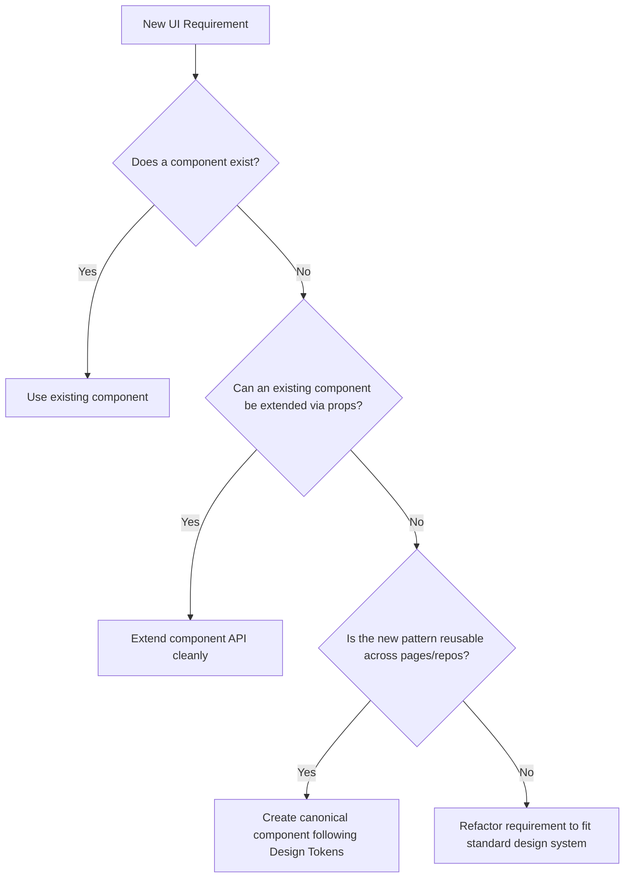

# dileepadev - Design System Specification & Frontend Guidelines

> **Practical visual guidance for AI coding agents** working on the dileepadev platform UI.
> This document synthesises the brand guide and the design-system contract into an
> agent-optimised reference with machine-readable frontmatter, golden rules, and a
> component checklist.
>
> All frontend applications, human engineers, and AI coding agents MUST adhere to the standards,
> tokens, and rules defined in this document. Do not fork or invent divergent patterns in
> individual applications.

## Related documents

| Document | Authority | Purpose |
| :--- | :--- | :--- |
| [`brand-guide.md`](docs/brand/brand-guide.md) | Brand identity authority | Colour, type, logo, voice, portrait - the *what* and *why* of the brand |
| [`design-system.md`](docs/brand/design-system.md) | Implementation contract authority | Tokens, components, states, layout, theming - the *how* |
| [`brand-tokens.css`](docs/brand/brand-tokens.css) | Token authority | Every value, vendored into each consuming repo |
| **This file (`DESIGN.md`)** | AI agent reference | Synthesises both into actionable rules, machine-readable YAML, component checklists |
| `dileepa-dev` (`app/globals.css`, `/brand`) | Flagship implementation | The site the system was designed on; `/brand` is the live reference |

---

## Table of Contents

1. [Golden Rules for AI Coding Agents](#1-golden-rules-for-ai-coding-agents)
2. [Core Design Principles](#2-core-design-principles)
3. [Brand & Visual Identity](#3-brand--visual-identity)
4. [Design Tokens Reference](#4-design-tokens-reference)
5. [Color System & Theming](#5-color-system--theming)
6. [Typography & Text Hierarchy](#6-typography--text-hierarchy)
7. [Layout & Spatial Architecture](#7-layout--spatial-architecture)
8. [Responsive Design & Breakpoints](#8-responsive-design--breakpoints)
9. [Components & UI Patterns](#9-components--ui-patterns)
10. [Interaction States & Feedback](#10-interaction-states--feedback)
11. [Forms & Data Entry](#11-forms--data-entry)
12. [Tables & Data-Dense Interfaces](#12-tables--data-dense-interfaces)
13. [Icons, Media & Visual Assets](#13-icons-media--visual-assets)
14. [Borders, Radius & Elevation](#14-borders-radius--elevation)
15. [Motion & Animation](#15-motion--animation)
16. [Accessibility (a11y) Standards](#16-accessibility-a11y-standards)
17. [Content & Copywriting Standards](#17-content--copywriting-standards)
18. [Component Architecture & Extension Rules](#18-component-architecture--extension-rules)
19. [Do's and Don'ts Summary](#19-dos-and-donts-summary)

---

## 1. Golden Rules for AI Coding Agents

1. **No Brand Hue**: The accent is the text colour (`var(--brand)` = near-white on dark,
   near-black on light). Never introduce a hue as an
   accent. Colour appears only as a state: `--success`, `--error`, `--warning`.
2. **Never Type Hex `#` in Components**: Every colour resolves from a semantic variable
   (`--fg`, `--fg-body`, `--fg-muted`, `--bg-surface`, `--border-strong`, …).
3. **Three Text Steps**: titles `--fg`, paragraphs `--fg-body`, dates/names/labels `--fg-muted`.
4. **Sentence Case Everywhere**: headings, buttons, tabs, badges, nav. No Title Case, no ALL-CAPS
   (proper nouns and acronyms excepted - the role is `AI Engineer`).
5. **Weights 400, 500, 700 Only** - and 700 only on the display line and `<strong>`. Every heading
   is 500.
6. **Nothing Below 13px**: `--text-label` is the floor.
7. **Corners Follow Three Rules**: fixed for containers (`--radius-panel`, `--radius-tile`,
   `--radius-block`, `--radius-inline`), capsule for every control, concentric when nested.
8. **An Edge Means It Acts**: buttons, selects and interactive chips take `--border-strong`;
   fields take `--border-input`; labels take no edge.
9. **Every Text Link Carries Its Arrow**: `→` on the site, `↗` off it. Prose links are underlined.
10. **One Control Height (40px)**: `--control-h`.
11. **No Banned Jargon in Copy** (§17.2).

---

## 2. Core Design Principles

Developer-tool craftsmanship, clarity and deliberate minimalism: no decoration without a job.

### 2.1 Content-First Restraint

Every pixel serves the content. If a border, background or effect doesn't clarify hierarchy or
readability, remove it. Negative space is a structural choice.

### 2.2 Contrast Is the Accent

There is no brand hue. Full-contrast ink marks what deserves attention - a title, the one primary
action, the current item - and everything else sits a step down. If everything on a screen is at
full contrast, nothing is emphasised.

### 2.3 One Filled Action per Surface

The primary button's fill is the text colour; it is the loudest thing a surface can hold. One per
panel, form or dialog.

### 2.4 Quiet Structure, Clear Objects

Panels are surfaces, cards are a step down on them, rules are quiet hairlines, and an edge is kept
for things you can press.

### 2.5 Predictable, Universal Interaction

- Controls lift to `var(--surface-hover)` on hover; text links step down to `--fg-muted`.
- Every state change runs at `--dur` (160ms) on `--ease`.
- Focus: one 2px edge on a field; the 3px ring where there is no edge to change.

### 2.6 Sentence Case Everywhere

All titles, links, buttons, table headers, badges and labels use sentence case. **The role is a
proper noun: `AI Engineer`** - title case wherever it is a label (the `<title>`, `jobTitle`, the
line under the portrait, the terminal profile). The discipline stays lowercase in prose.

---

## 3. Brand & Visual Identity

### 3.1 The Logo Lockup

The handle is the logo: **`@dileepadev`**.

```html
<!-- Canonical markup -->
<a href="/" class="lockup" aria-label="dileepadev - home">
  <span class="mark" aria-hidden="true">@</span>
  <span class="wordmark">dileepadev</span>
</a>
```

- **Mark (`@`)**: Manrope 500, `var(--fg-muted)`, `-0.02em` tracking.
- **Wordmark (`dileepadev`)**: Manrope 500, `var(--fg)`, `-0.02em` tracking, all lowercase.
- **Spacing**: no gap (`gap: 0.02em`) - one word. Never shrinks or wraps.
- Black and white only. Never coloured, outlined, gradiented or rotated.

### 3.2 The Accent

- **Dark (Carbon)**: the accent is Ink 100 `#F1F1F1` - 18.0:1 on the page.
- **Light (Paper)**: the accent is Paper 900 `#131313` - 17.3:1 on the page.
- Text on the primary fill is the page foundation: 18.0:1 / 17.3:1.

### 3.3 Tone of Voice

Direct, technical and understated. An engineer explaining real systems to peers.

---

## 4. Design Tokens Reference

Applications MUST vendor the canonical token sheet (`docs/brand/brand-tokens.css`) and import it
into a cascade layer, or wire their framework (Tailwind 4 `@theme inline`) to it.

### 4.1 Raw Color Palette

*Raw tokens exist for derivation. Components never reference them.*

| Token | Hex | Role |
| :--- | :--- | :--- |
| `--carbon` / `--ink-900` | `#050505` | Dark canvas |
| `--ink-800` | `#0d0d0d` | Dark panel surface |
| `--ink-700` | `#141414` | Dark raised surface |
| `--ink-600` | `#1f1f1f` | Dark structural rule |
| `--ink-500` | `#2e2e2e` | Dark component edge |
| `--ink-400` | `#8d8d8d` | Dark muted text (6.1:1) |
| `--ink-100` | `#f1f1f1` | Dark primary text and accent (18.0:1) |
| `--paper` / `--paper-50` | `#f7f7f7` | Light canvas |
| `--paper-0` | `#ffffff` | Light surface |
| `--paper-200` | `#e3e3e3` | Light structural rule |
| `--paper-300` | `#d2d2d2` | Light component edge; the portrait field |
| `--paper-400` | `#6a6a6a` | Light muted text (5.0:1) |
| `--paper-900` | `#131313` | Light primary text and accent (17.3:1) |

### 4.2 Semantic Color Tokens

| Token | Dark | Light | Use |
| :--- | :--- | :--- | :--- |
| `--bg` | `#050505` | `#f7f7f7` | Page canvas; a card on a panel |
| `--bg-surface` | `#0d0d0d` | `#ffffff` | Panels, fields, the nav |
| `--bg-raised` | `#141414` | `#ffffff` | Menus, code blocks |
| `--border` | `#1f1f1f` | `#e3e3e3` | Structural rules |
| `--border-strong` | `#2e2e2e` | `#d2d2d2` | Edges of things that act |
| `--border-input` | `#5b5b5b` | `#8f8f8f` | Field edges (3.0:1, WCAG 1.4.11) |
| `--fg` | `#f1f1f1` | `#131313` | Titles, emphasis |
| `--fg-body` | `#a8a8a8` | `#4f4f4f` | Running text (8.6:1 / 7.6:1) |
| `--fg-muted` | `#8d8d8d` | `#6a6a6a` | Dates, names, labels |
| `--brand` / `--brand-fill` | `#f1f1f1` | `#131313` | The accent: primary fill, current marks, focus, prose links |
| `--on-brand` | `#050505` | `#f7f7f7` | Text on the primary fill |
| `--success` | `#23b888` | `#087f5b` | A completed action - state only |
| `--error` | `#e5484d` | `#c4292e` | Errors (5.2:1 / 5.3:1) |
| `--warning` | `#d97706` | `#b45309` | Cautions - state only |

### 4.3 Derived Interaction Tokens

```css
:root {
  --surface-hover: color-mix(in srgb, var(--fg) 7%, var(--bg-surface));
  --raised-hover: color-mix(in srgb, var(--fg) 9%, var(--bg-surface));

  /* The fill is the text colour, so its steps ease toward the background. */
  --brand-fill-hover: color-mix(in srgb, var(--brand-fill) 86%, var(--bg));
  --brand-fill-active: color-mix(in srgb, var(--brand-fill) 76%, var(--bg));

  --ring: color-mix(in srgb, var(--brand) 32%, transparent);
  --ring-width: 3px;
}
```

### 4.4 Spacing Scale

`--space-1` (4px) to `--space-16` (64px): 1, 2, 3, 4, 5, 6, 8, 10, 12, 16. Never invent a value.

### 4.5 Radius & Hairlines

| Token | Value | Rule | Applied To |
| :--- | :--- | :--- | :--- |
| `--radius-panel` | 32px | Fixed | Page panels, the rail, the footer, the mobile menu |
| `--radius-tile` | 22px | Fixed | Cards on a panel, menus, toasts |
| `--radius-block` | 12px | Fixed | Images, code, icon wells inside a card |
| `--radius-inline` | 6px | Fixed | Inline code, keys |
| `--radius-pill` | 999px | Capsule | Every control; an icon alone is a circle |
| `--radius-field` | 20px | Capsule | Fields (half `--control-h`; a textarea keeps its ends) |
| `--radius-row` | 16px | Concentric | A row 6px inside a tile |
| `--hairline` | 1px | - | Every border and rule |

`--radius` and `--radius-xl` are deprecated; don't use them in new work.

### 4.6 Control Heights

`--control-h: 40px` for buttons, fields, search, selects and toggles - one baseline.

### 4.7 Motion & Timing

`--dur: 160ms`, `--ease: cubic-bezier(0.4, 0, 0.2, 1)` for every state change. See §15.

---

## 5. Color System & Theming

### 5.1 Theme Cascading Order

- Default: dark (`:root`, `[data-theme="dark"]`).
- Light: `[data-theme="light"]`.
- System preference applies light when `prefers-color-scheme: light` and no choice is stored.
- Persist the choice under `dileepa-theme` on every surface.

### 5.2 Text Selection

```css
::selection {
  background: color-mix(in srgb, var(--brand) 28%, transparent);
  color: inherit;
}
```

### 5.3 Semantic Status Colours

- **Success** (`--success`): a copy confirmation's tick, a sent message.
- **Error**: destructive states, validation errors, failures.
- **Warning**: non-blocking cautions. Never decorative.

---

## 6. Typography & Text Hierarchy

### 6.1 Font Families

| Role | Family | Used For |
| :--- | :--- | :--- |
| **Sans / UI** | `Manrope` | Display, headings, body, controls, navigation |
| **Monospace** | `JetBrains Mono` | Code, dates, route paths, metadata |

### 6.2 Type Weights

- **400**: body and lead text.
- **500**: every heading (H1-H3), labels, buttons, nav, the lockup.
- **700**: the display line and `<strong>` - nothing else.
- **600 is prohibited.**

### 6.3 Type Scale

| Step | Size | Line Height | Tracking | Weight | Use |
| :--- | :--- | :--- | :--- | :--- | :--- |
| `display` | 44 → 80px (fluid) | 1.02 | -0.04em | 700 | Hero statement |
| `h1` | 36 → 56px (fluid) | 1.06 | -0.04em | 500 | Page titles |
| `h2` | 28px | 1.2 | -0.02em | 500 | Section titles |
| `lead` | 20 → 26px (fluid) | 1.35 | 0 | 400 | A section's opening sentence |
| `h3` | 19px | 1.35 | 0 | 500 | Card, item, subsection titles |
| `body` | 17px | 1.65 | normal | 400 | Running text |
| `small` | 15px | 1.55 | normal | 400 | Captions, metadata, button labels |
| `label` | 13px | 1.45 | 0.01em | 500 | Badges, chips, dates - the floor |

Title-role text at the H3 size takes `-0.02em`; the bare `<h3>` does not.

### 6.4 Readability & Line Length

Running prose caps at **68ch**. Paragraphs are `--fg-body`, never `--fg` (competes with the
heading) or `--fg-muted` (reads as metadata).

---

## 7. Layout & Spatial Architecture

### 7.1 The Shell: Rail and Panels

```css
.shell {
  width: min(100% - var(--space-10), 1320px);
  margin-inline: auto;
}
```

- **≥1024px**: a sticky **profile rail** (21rem) - portrait, name, role, status, "Get in touch",
  the navigation as one flowing list of chips, socials - beside a column of **panels**.
- **<1024px**: the rail hides and a **floating nav** takes over.
- Every section, the rail and the footer is a panel: `--bg-surface`, a `--border-strong`
  hairline, `--radius-panel`, padding `--panel-pad`, `--space-6` apart.
- Panels are size containers (`container: section`): grids inside them split on the panel's
  width, not the window's.

### 7.2 Pages

- The homepage is the front door: the hero (with the newest post, talk and video), About, Contact.
- Work and Education are pages beside Projects, Blog, Events, Communities, Videos and Gallery.
- An index page opens on the path capsule, the `<h1>`, a count badge and the lead - nothing else.
- Short pages end on **Keep exploring**: three tiles to related pages.

---

## 8. Responsive Design & Breakpoints

| Threshold | Behaviour |
| :--- | :--- |
| `1024px` | Rail and panels above; floating nav and stacked panels below |
| `720px` | Item lists and wide grids collapse to one column |
| Panel container queries | Card grids and splits follow each panel's own width |

- **Touch targets** measure at least 44×44px; small visuals extend their hit area.
- **No horizontal scroll**, ever: tables and code scroll in their own box, flexible grid tracks
  get `min-width: 0`. Check at 390px.

---

## 9. Components & UI Patterns

### 9.1 Buttons (`Button`, `LinkButton`)

Capsules at `--control-h`, Small (15px) weight 500, padding `0 var(--space-5)`.

- **Primary**: `--brand-fill` (the text colour) with `--on-brand` text; hover/active ease toward
  the background. One per surface.
- **Secondary**: transparent, `--border-strong` edge, `--fg` text; hovers to `--surface-hover`.

### 9.2 Links

- Default colour `inherit`. **Every text link (`.text-link`) carries an arrow** - `→` internal,
  `↗` for `target="_blank"` - because there is no link colour to mark it. Hover steps the text to
  `--fg-muted`.
- Nav chips, buttons, social icons and `.view-all` carry no extra arrow.
- `.prose a`: underlined at `--brand`; an external one still takes `↗`.

### 9.3 Panels and Cards

- **Panel**: `--bg-surface`, `--border-strong`, `--radius-panel`, `--panel-pad`.
- **Card**: one step down - `--bg`, no edge, `--radius-tile`, `--space-6` padding. Meta row,
  the title as the only link, up to three lines of `--fg-body`, a foot of chips. **A card is not a
  link; its title is.**

### 9.4 Section and Page Headings

- **Section**: heading at `clamp(2rem, 1.35rem + 2.2vw, 3rem)`, 500, `-0.03em`; a lead in
  `--fg-muted`; an **app-icon tile** top right - 7.5rem, 1.75rem radius, a top-lit gradient,
  one Lucide icon at 4rem stroke 1.5, over a faint dot field.
- **Subsection**: a `<span>` at the H3 size with a 16px icon - not a heading.
- **Page**: path capsule (`home / blog`), `<h1>`, count badge ("22 Posts"), lead.

### 9.5 Badges, Chips & Status

- Capsules, `--text-label` 500. **Labels have no edge**; interactive chips take
  `--border-strong`; on hover they lift to `--surface-hover` with a `--brand` edge.
- **Status dot**: 8px in `--brand` before "Open to work" / "Current" / "Upcoming", with a slow 2s
  pulse (still under reduced motion).
- **Date stamp**: day at the H2 size, a hairline, month over year at Small.

### 9.6 Page Path (`PagePath`)

`home / section / slug`, every segment a link, mono Label in a capsule.

### 9.7 Search (`SearchInput`)

A field at `--control-h`: leading icon, clear button, `/` hotkey indicator. `/` focuses it;
`Escape` clears or blurs.

### 9.8 Filters and Sort (`FilterSelect`, `SortSelect`)

Capsule triggers with `--border-strong`. Unfiltered reads **"Status: All"**; the menu keeps
"All types" as its first option. Menus on `--bg-raised` at `--radius-tile`, rows at
`--radius-row`. An open trigger draws a 2px `--brand` edge. Full keyboard support
(`combobox`/`listbox`, arrows, Enter, Space, Escape).

### 9.9 Lists

- **Roles**: one tile per role - date pill, title, organisation, `--fg-body` description.
- **Courses**: a two-up grid of the same tile.
- **Item lists**: hairline-separated rows, content left, metadata right; one column below 720px.

### 9.10 Empty States (`EmptyState`)

A sentence-case title, a hint that says how to make something appear, an optional action.

### 9.11 Navigation

- **Rail (≥1024px)**: chips as one list - Home, About, Work, Education, Contact, then the index
  pages. Long reading pages turn the rail into a table of contents.
- **Floating nav (<1024px)**: a 60px capsule on `--bg-surface` with `--shadow-nav` - lockup,
  theme toggle, menu button. The menu's groups are **About me** and **Explore** (the footer's
  names too).
- Current state: a section link while its section is in view, a page link while its page is open.
  Colour and fill only - never a weight change.

### 9.12 Copy, Back to Top, Toasts

- **Copy buttons**: the icon becomes a `--success` tick (grows in at `--dur`) and the label reads
  "Copied" for two seconds; screen readers hear "Copied to clipboard"; failures are said in a toast.
- **Back to top**: a 40px circle after 400px of scroll, its edge a reading-progress ring - a
  `--border-strong` track and a 2px `--fg` arc filling clockwise with the scroll.
- **Toasts**: `--bg-surface`, `--border` hairline, `--radius-tile`, Small text.

---

## 10. Interaction States & Feedback

| State | Visual Behaviour | Rule |
| :--- | :--- | :--- |
| **Default** | Resting tokens | - |
| **Hover** | Controls → `--surface-hover`; primary → `--brand-fill-hover`; text links → `--fg-muted` | `--dur`, `--ease` |
| **Focus-visible** | Fields: one 2px `--brand` edge. Everything else: the 3px `--ring` | `:focus-visible` only; never both |
| **Active** | `--raised-hover`; primary → `--brand-fill-active` | Immediate |
| **Disabled** | 50% opacity, `not-allowed`, hover suppressed | `disabled` + `aria-disabled` |
| **Invalid** | `--error` edge + a message beneath (§11.4) | After a submit attempt |

---

## 11. Forms & Data Entry

### 11.1 Form Layouts

Single column, or a two-up grid with `--space-5` gaps. Controls fill their track.

### 11.2 Field Labels

Every field has a programmatic `<label>` above it (Small, 500). Required fields carry a `*` in
`--brand` and `required`. No floating labels.

### 11.3 Input Sizing & Edges

- Single-line fields: exactly `--control-h`, `--radius-field` (a capsule), `--border-input`.
- Textareas: min-height 140px (96px for comments), `resize: vertical`, the same end radius.
- **Focus**: the border turns `--brand` and an inset 1px makes it 2px - no halo.

### 11.4 Validation Messages

The system's own, never the browser's bubble:

- Forms are `noValidate`; rules stay `required` / `type="email"`, read through the constraint
  validation API (a shared `useFormErrors` hook on `dileepa-dev`).
- On submit, each failure is written under its field - Small, `--error`, led by an alert icon;
  the field takes an `--error` edge (kept on hover, 2px on focus), `aria-invalid` and
  `aria-describedby`; focus moves to the first failure; nothing is sent until all pass.
- A message clears the moment its field is acceptable. No checking before the first submit.
- Copy says what to do: "Enter your name.", "Enter an email address like `jane@example.com`."

---

## 12. Tables & Data-Dense Interfaces

### 12.1 Table Structure

Horizontal `--border` rules only. Rows 44-52px (36px compact). Cells `--space-3 var(--space-4)`.
Header cells mono, `--fg-muted`, weight 400, sentence case.

### 12.2 Column Alignment

Text left; numbers, dates and statuses in mono, right-aligned or centred; actions pinned right.

### 12.3 Responsive Tables

More than three columns scroll inside their own box (`overflow-x: auto`, `--border-strong` edge,
`--radius-tile`) - the page never scrolls sideways.

---

## 13. Icons, Media & Visual Assets

### 13.1 Icons

- **Interface**: Lucide (`lucide-react`). 16px in controls, 14px inline; 4rem stroke 1.5 in the
  section app-icon tiles. Section icons are literal: a person (About), a briefcase (Work), a
  graduation cap (Education), speech bubbles (Contact).
- **Social**: hand-authored inline SVGs, 24×24, `fill="currentColor"`, `--fg-muted` → `--fg`.
- **Pillar marks** (`docs/brand/icons/`): unused by any surface since the About cards were removed kept as assets.
- Decorative icons carry `aria-hidden="true"`.

### 13.2 Photography Budget

Three places only: **the portrait** (rail, phone hero, profile), **event photographs** (gallery,
event pages) and **video thumbnails** on `/videos`: 16:9, beside each video's title in a list, never
a wall of thumbnails, with the length on a fixed dark scrim. Blog posts carry no banner. Photos sit
at `--radius-block`; captions over a fixed dark scrim.

---

## 14. Borders, Radius & Elevation

### 14.1 Surface-First Elevation

Depth is a surface step (`--bg` → `--bg-surface` → `--bg-raised`; a card steps back to `--bg`).
No shadows on cards, buttons, chips or fields.

### 14.2 Sanctioned Effects

- `--shadow-nav` on the floating nav, the one floating element.
- The app-icon tile's gradient and soft shadow, the one decorated mark.
- A faint dot field at section corners, never behind text.
- The gallery caption scrim.

No glows. No hue gradients.

---

## 15. Motion & Animation

### 15.1 Purposeful Motion Only

Every state change: `--dur` (160ms) on `--ease`. Longer motion only answers an action or marks
something live:

- **Page change**: old page fades out (160ms); new page fades in after 100ms, rising 6px (280ms).
- **Image viewer**: opens at 220ms / 300ms, closes in 200ms.
- **Menus** scale-and-fade in; **copy ticks** grow in; **field errors** fade in rising 2px.
- **Status dots** pulse softly (2s). **The back-to-top ring** follows the scroll.

No fade-up-on-scroll, parallax or bounce.

### 15.2 Reduced Motion

Under `prefers-reduced-motion: reduce`, every view transition swaps instantly and every animation
stops:

```css
@media (prefers-reduced-motion: reduce) {
  ::view-transition-group(*),
  ::view-transition-old(*),
  ::view-transition-new(*) {
    animation: none !important;
  }
}
```

---

## 16. Accessibility (a11y) Standards

### 16.1 Contrast

Normal text ≥ 4.5:1, large text and non-text edges ≥ 3:1. Measured: `--fg` 18.0:1, `--fg-body`
8.6:1, `--fg-muted` 6.1:1 on dark; 17.3:1, 7.6:1, 5.0:1 on light; field edges 3.0:1.

### 16.2 Visible Focus

Every focusable element has a `:focus-visible` indicator: one 2px edge on fields, the 3px ring
elsewhere. Never `outline: none` without one of them.

### 16.3 Semantic HTML

Real `<main>`, `<nav>`, `<header>`, `<footer>`, `<section>`, `<article>`, `<button>`, `<dialog>`.
Never a clickable `<div>`.

### 16.4 Heading Order

Levels describe the outline; the scale describes size. On the homepage: `h1` (hero) → `h2`
(section) → `h3` (item). On an index or a page like `/work`, the list sits directly under the
`h1`, so its titles are `h2`. Subsection titles are `<span>`s, not headings.

### 16.5 Accessible Names Contain the Visible Label

WCAG 2.5.3. An `aria-label` must contain the visible text in order; announce extra context in an
`sr-only` span instead of replacing the name.

---

## 17. Content & Copywriting Standards

### 17.1 Sentence Case

Headings, buttons and badges in sentence case: "Talks and workshops", "Send message",
"Open source".

### 17.2 Banned Copywriting Jargon

*passionate about, leveraging, cutting-edge, revolutionize, game-changing, unlock, seamless, AI
enthusiast, thought leader, journey, humbled to announce, 10x.*

---

## 18. Component Architecture & Extension Rules



### Component Development Checklist

1. **Tokens only** - no hex, no invented radius or spacing.
2. **Corners** - fixed, capsule or concentric.
3. **Edges** - only on things that act.
4. **Text** - three steps, 13px floor, weights 400/500/700.
5. **Keyboard** - reachable with Tab, operable with Enter/Space, visible focus.
6. **Both themes**, **390px** and **1024px+**, no horizontal scroll.
7. **Sentence case.**

---

## 19. Do's and Don'ts Summary

| Category | Do | Don't |
| :--- | :--- | :--- |
| **Color** | Let contrast carry emphasis; use colour only for a state. | Add a brand hue. |
| **Text** | `--fg` titles, `--fg-body` paragraphs, `--fg-muted` metadata. | Set paragraphs at full contrast or below 13px. |
| **Typography** | Weights 400/500, 700 only on the display and `<strong>`. | Load 600, or bold every heading. |
| **Shape** | Fixed containers, capsule controls, concentric nesting. | Invent a radius, or mix squared controls in. |
| **Edges** | Edge the things that act; fields at `--border-input`. | Outline a label so it looks like a button. |
| **Links** | Give every text link its arrow. | Leave a clickable title looking like plain text. |
| **Buttons** | One filled primary per surface. | Stack competing primaries. |
| **Focus** | One 2px edge on fields; the ring elsewhere. | Draw a ring around an already-highlighted edge. |
| **Motion** | 160ms state changes; motion that answers an action. | Fade every section in on scroll. |
| **Copy** | State facts and real outcomes. | "Cutting-edge", "seamless", "journey". |

---

*This file is the canonical DESIGN.md specification for the dileepadev platform. All frontend
applications and AI agents must apply these rules whenever generating or modifying frontend code.*
